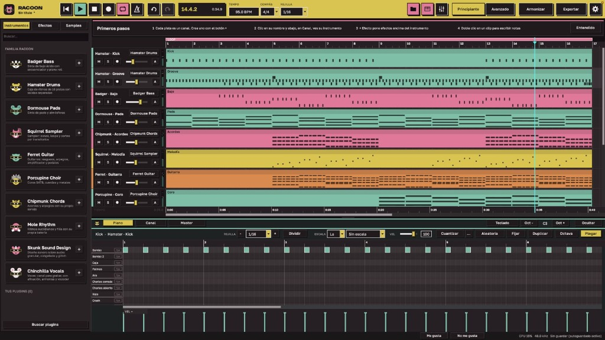

# Racoon

> **A complete, open-source music production ecosystem.**  
> An arrangement-focused Digital Audio Workstation (DAW) accompanied by a suite of 11 professional instrument and effect plugins (VST3, Audio Unit, and Standalone).

[English](README.md) | [Español](README.es.md)

[](https://github.com)
[](estudio/LICENSE)
[](plugins/LICENSE)
[](#language--idioma)

<p align="center">
  
</p>

*Para consultar la versión en español de este documento, visita [`README.es.md`](README.es.md). Para el registro de cambios original y detallado, consulta [`LEEME.txt`](LEEME.txt).*

---

## Table of Contents

- [Overview](#overview)
- [The 11 Plugins Family](#the-11-plugins-family)
- [Racoon Studio (The DAW)](#racoon-studio-the-daw)
- [Key Features](#key-features)
  - [Intelligent Composition & Arrangement](#intelligent-composition--arrangement)
  - [Hum-to-Song (Voice & Beatbox to Stems)](#hum-to-song-voice--beatbox-to-stems)
  - [DJ Mode & Harmonic Mixing](#dj-mode--harmonic-mixing)
  - [Automated Mixing & Mastering](#automated-mixing--mastering)
  - [Offline Stem Separation](#offline-stem-separation)
  - [Sample Library & Clean Track Certificate](#sample-library--clean-track-certificate)
- [Installation & Setup](#installation--setup)
  - [macOS (One-Click Installer)](#macos-one-click-installer)
  - [Windows](#windows)
  - [Linux](#linux)
- [Repository Structure](#repository-structure)
- [DSP & Technical Highlights](#dsp--technical-highlights)
- [Attributions & Licenses](#attributions--licenses)

---

## Overview

**Racoon** is an integrated audio creation suite designed for producers, composers, sound designers, and live performers. It consists of:

1. **Racoon Studio (`estudio`)**: A high-efficiency arrangement-based DAW built with JUCE and Tracktion Engine, featuring timeline sequencing, pitch and warp editing, native mixer routing, offline stem extraction, and 55+ internal studio DSP effects.
2. **Racoon Plugins Suite (`plugins`)**: 11 animal-themed instruments and processors available in VST3, Audio Unit, and Standalone formats, functioning both inside Racoon and in any third-party host (Ableton Live, Logic Pro, Reaper, FL Studio, Bitwig, Cubase).
3. **Muestras Racoon (`muestras`)**: A 100% royalty-free open sample and instrument library containing over 3,000 drum hits, 76 multi-sampled SFZ acoustic and electric instruments, 5,000+ single-cycle waveforms, and 1,200+ genre-specific transition FX.

---

## The 11 Plugins Family

All 11 plugins share a unified workflow: built-in standalone playback with preset audio demos, undo/redo, 1-to-8 bar pattern sequencers / piano rolls, computer keyboard MIDI input, parameter automation via MIDI CC, and the **"A la maqueta" (To Arrangement)** transfer button.

| Plugin | Animal & Role | Category | Key Capabilities |
| :--- | :--- | :--- | :--- |
| **Racoon - Badger Bass** | Badger (Acid Bass) | Instrument | Dual-oscillator acid bass synthesizer, 303-style slides and accents, sub-oscillator, analog drift, saturation, and integrated step sequencer. |
| **Racoon - Hamster Drums** | Hamster (Drum Machine) | Instrument | 16-pad drum machine with individual channel outputs, multi-velocity sample layers, transient-aligned sub-layering, envelope shaping, and 42 factory kits. |
| **Racoon - Dormouse Pads** | Dormouse (Atmospheric Pads) | Instrument | Wavetable & granular pad synth with unison detune, band-limited VA oscillators, analog drift, 4 envelopes, and 4 multi-wave LFOs. |
| **Racoon - Squirrel Sampler** | Squirrel (Chromatic Sampler) | Instrument | Full-featured SFZ multi-sampler with velocity zones, round-robin alternations, 32-point sinc resampling, and transient slicing. |
| **Racoon - Ferret Guitar** | Ferret (Modeled & Sampled Guitar) | Instrument | Physical modeling & 5 sampled guitars (Acoustic, Electric Clean, High-gain, Nylon), 7 rhythm playing styles, 10 articulations (palm mute, slides, hammer-ons), stompbox pedalboard, and cabinet simulator. |
| **Racoon - Porcupine Choir** | Porcupine (Vocal Ensemble & Choir) | Instrument | SATB choir synthesizer and harmonizer with automatic voice leading, vowel/syllable morphing, stage acoustic positioning, and 8 separate outputs. |
| **Racoon - Chipmunk Chords** | Chipmunk (Harmonic Keyboard & Chords) | Instrument / MIDI | Chord generator, arpeggiator, and strum engine with 10 acoustic/electric keyboard sounds (Grand Piano, Electric Piano, FM, Harpsichord, Strings). Generates and outputs polyphonic MIDI. |
| **Racoon - Mole Rhythm** | Mole (Percussion & Polyrhythm) | Instrument / MIDI | 16-lane groove generator featuring Euclidean rhythms, probability gates, ratchets, swing microtiming, and internal acoustic/electronic percussion engine. |
| **Racoon - Skunk Sound Design** | Skunk (Experimental FX Lab) | Audio Effect | Sound design processor featuring granular resynthesis, spectral freeze, real-time audio morphing, stutter/glitch buffer, and a 64-point modulation matrix. |
| **Racoon - Hedgehog Mastering** | Hedgehog (Mastering Suite) | Master FX | Multi-stage mastering processor featuring the single-knob "Partícula" macro, 12-band dynamic EQ, 6-band multiband compressor, resonance tamer, match EQ, and EBU R128 / true-peak metering. |
| **Racoon - Chinchilla Vocals** | Chinchilla (Vocal Processing Lab) | Vocal FX | Real-time pitch correction, graphical pitch curve editor, formant shifter, 8-part harmonizer, doubler, vocoder, talkbox, and rhythmic vocal chopper. |

---

## Racoon Studio (The DAW)

Racoon Studio focuses on songwriting, electronic music production, and rapid arrangement without the complexity of traditional multi-window setups.

```
+------------------------------------------------------------------------------------+
|  Top Bar: Transport | BPM | Meter | Camelot Key | Harmonize | Export | CPU Meter   |
+--------------------------+---------------------------------------------------------+
| Browser / Library        | Timeline Arrangement View                               |
| - Instruments (11 Plugins)| Track 1: Kick & Sub   [■■■■■■■■■■■■■■■■■■■■■■■■■■■■■■■]  |
| - 55 Native Audio Effects| Track 2: Drum Groove  [  ■■■■  ■■■■  ■■■■  ■■■■  ■■■■ ]  |
| - Muestras Racoon Samples| Track 3: Bassline     [■■■■■■■■    ■■■■■■■■    ■■■■■■■■]  |
| - Project Audio Assets   | Track 4: Chords & Pad [==============================]  |
| - Transitions & FX       | Track 5: Vocal Lead   [   ~~~~~~       ~~~~~~     ]  |
+--------------------------+---------------------------------------------------------+
| Bottom Dock: [ Piano Roll / Drum Grid ]  [ Channel Chain & FX Cards ]  [ Master Bus ]|
+------------------------------------------------------------------------------------+
```

- **Clean Single-Window Layout**: Resizable workspace with immediate access to timeline clips, inspector cards, piano roll, and master bus.
- **55 Internal Native Audio Effects**: Dynamics (Bus Compressor, Multi-band, Gate, Clipper), EQ (8-Band, 3-Band, Dynamic Mix EQ), Modulation (Chorus, Phaser, Flanger, Tremolo), Saturation (Tape, Valve, ADAA Overdrive, Amp & Cab simulator), Time & Space (Granular Delay, FDN Reverb, OpenAIR Convolution Reverb), and Spectral/Creative tools.
- **Camelot Wheel Integration**: Real-time project harmonic transposition. Switch keys with a single click while preserving scale modes and melodic intervals.

---

## Key Features

### Intelligent Composition & Arrangement
- **44 Built-in Genre Blueprints**: Instantly bootstrap a full track across 44 genres (Deep House, Techno, Trap, Reggaeton, Drum & Bass, Lo-Fi, Synthwave, Funk, etc.). Each genre loads authentic drum patterns, basslines, chord progressions, instrument presets, and vocal chops tuned to its Camelot key.
- **Musical Randomization (ALEATORIA)**: Non-destructive algorithm generating idiomatic musical parts based on compositional rules (voice leading, syncopation, call-and-response, bass root motion).
- **Structure Generator**: Transform a 16-bar idea into a complete song structure with Intro, Build-up, Drop, Breakdown, Drop 2, and Outro with automated transition FX.

### Hum-to-Song (Voice & Beatbox to Stems)
- Record a hummed melody and a beatbox rhythm directly into Racoon or import an audio file.
- The engine uses the **YIN algorithm** to track fundamental frequencies every 10 ms, detects key center and scale, quantizes notes, derives harmonic progressions, and assigns parts to lead, bass, chords, and drum tracks.

### DJ Mode & Harmonic Mixing
- Drag and drop audio files (WAV, AIFF, FLAC, MP3).
- Racoon computes precise tempo down to the hundredth (e.g. `126.00 BPM`), Camelot musical key (`8A`, `9B`), and an energy rating (1 to 10).
- Automatically orders playlists for smooth harmonic transitions and tempo shifts under 6%, exports `.m3u` playlists with transition logs, and can generate custom 128-bar club tool tracks to mix between songs.

### Automated Mixing & Mastering
- **One-Click Mix & Master (`Cmd + Option + M`)**: Analyzes the stem sum, measures integrated loudness, true-peak, presence (2–6 kHz), and sub-bass energy.
- Automatically adjusts channel EQs, applies sidechain ducking to bass, cleans low-mid muddiness (60–250 Hz), widens stereo image, and limits output to target streaming specs (-14 LUFS for Spotify/chill, -10 LUFS for club).

### Offline Stem Separation
- Powered by Meta's **Demucs v4** neural network via embedded `demucs.cpp`.
- Right-click any audio clip and select **"Separar en stems"** to extract Drums, Bass, Vocals, and Other stems directly on CPU/Apple Silicon without internet access.

### Sample Library & Clean Track Certificate
- **Muestras Racoon**: Clean, curated library free of licensing conflicts.
- **Certificado de Rola Limpia (Clean Track Certificate)**: When exporting a finished song, Racoon audits every active sample, cross-references its database, and outputs a signed text verification with author credits, licenses (CC0, CC-BY, Public Domain), and a SHA-256 audio hash for YouTube / streaming distributor verification.

---

## Installation & Setup

### macOS (One-Click Installer)

Prerequisites: macOS 11.0 or newer (Universal: Apple Silicon M1/M2/M3/M4 & Intel). Xcode Command Line Tools (`xcode-select --install`).

1. Clone or download this repository:
   ```bash
   git clone https://github.com/danyparc/racoon.git
   cd racoon
   ```
2. Double-click **`Instalar Racoon.command`** in Finder, or run:
   ```bash
   ./"Instalar Racoon.command"
   ```
3. The script will:
   - Download the Demucs v4 offline stem separation model.
   - Assemble full multi-velocity acoustic sample libraries into `~/Music/Racoon/Muestras Racoon`.
   - Compile all 11 plugins (VST3 & Audio Unit) and place them in `~/Library/Audio/Plug-Ins/`.
   - Compile Racoon Studio and copy it to `/Applications`.
   - Create a standalone distributable `.dmg` inside the `Instalador/` directory.

### Windows

A GitHub Actions workflow is provided (`.github/workflows/windows.yml`) to automatically compile 64-bit VST3 binaries and `Racoon.exe`.

For local compilation using Visual Studio 2022:
```powershell
# 1. Fetch dependencies
bash estudio/scripts/fetch_deps.sh

# 2. Build the 11 Plugins (VST3)
cmake -S plugins -B plugins/build-win -G "Visual Studio 17 2022" -A x64
cmake --build plugins/build-win --config Release --parallel

# 3. Build Racoon Studio
cmake -S estudio -B estudio/build-win -G "Visual Studio 17 2022" -A x64
cmake --build estudio/build-win --config Release --target Racoon --parallel
```
Copy generated `.vst3` files to `C:\Program Files\Common Files\VST3\` and place `muestras/` in `Documents\Racoon\Muestras Racoon`.

### Linux

Linux builds are supported for headless testing and native compilation using Ninja:
```bash
git clone --depth 1 --branch 8.0.16-security https://github.com/juce-framework/JUCE.git plugins/JUCE
cmake -S plugins -B plugins/build-linux -G Ninja -DCMAKE_BUILD_TYPE=Release -DRF_TESTS=ON
cmake --build plugins/build-linux
```

---

## Repository Structure

```
racoon/
├── docs/
│   └── images/
│       └── racoon-studio.jpg   # Screenshot of Racoon Studio interface
├── Instalar Racoon.command     # One-click automated macOS installer and builder
├── README.md                   # Main project documentation (English)
├── README.es.md                # Documentación en español
├── LEEME.txt                   # Complete original documentation & changelog (Spanish)
├── .github/
│   └── workflows/windows.yml   # Windows CI compilation workflow
├── plugins/                    # The 11 Racoon audio plugins (C++ / JUCE)
│   ├── Plugins/                # Individual plugin sources:
│   │   ├── Badger/             #   Racoon - Badger Bass
│   │   ├── Chinchilla/         #   Racoon - Chinchilla Vocals
│   │   ├── Chipmunk/           #   Racoon - Chipmunk Chords
│   │   ├── Dormouse/           #   Racoon - Dormouse Pads
│   │   ├── Ferret/             #   Racoon - Ferret Guitar
│   │   ├── Hamster/            #   Racoon - Hamster Drums
│   │   ├── Hedgehog/           #   Racoon - Hedgehog Mastering
│   │   ├── Mole/               #   Racoon - Mole Rhythm
│   │   ├── Porcupine/          #   Racoon - Porcupine Choir
│   │   ├── Skunk/              #   Racoon - Skunk Sound Design
│   │   └── Squirrel/           #   Racoon - Squirrel Sampler
│   ├── Common/                 # Shared DSP routines, UI components, and framework
│   ├── Shared/                 # Cross-plugin communication and resource bundles
│   └── Tests/                  # Automated plugin unit & contract tests
├── estudio/                    # Racoon Studio (DAW application)
│   ├── Source/                 # Core engine, arranger, audio graph, mixing, UI
│   ├── Resources/              # Embedded assets, icons, and open fonts
│   ├── ThirdParty/             # Bundled third-party dependencies (demucs.cpp, etc.)
│   └── scripts/                # Packaging, installer scripts, and sample downloaders
└── muestras/                   # Royalty-free sample library
    ├── bateria/                # Acoustic and vintage electronic drum samples
    ├── percusion/              # World percussion, shakers, congas, bells
    ├── instrumentos/           # Multi-sampled SFZ acoustic and electric instruments
    ├── salas/                  # Impulse response files for convolution reverb (OpenAIR)
    ├── ondas/                  # Single-cycle waveforms (AKWF) & wavetable files
    ├── efectos/                # Synthesized and recorded genre transitions
    ├── catalogo.json           # Sample metadata and category taxonomy
    ├── kits-racoon.json        # 360 pre-engineered drum kit recipes
    └── CREDITOS.txt            # Full author attribution and licenses per sample library
```

---

## DSP & Technical Highlights

- **Anti-Aliased Non-Linearities (ADAA)**: 1st-order Antiderivative Anti-Aliasing (Parker, Zavalishin, Bilbao) implemented in clipping, drive, saturation, and amp modeling to preserve pristine high-frequency content without heavy CPU oversampling.
- **Topology-Preserving Transform (TPT) Filters**: Zero-delay feedback state-variable filters with smooth sample-accurate modulation.
- **Bandlimited Oscillators**: PolyBLEP step-correction applied across saw, pulse, and square waves for clean analog synthesis.
- **High-Precision Sinc Resampling**: 32-point Kaiser-windowed sinc interpolation with error floor under -124 dB.
- **Hadamard Feedback Delay Networks (FDN)**: 8-line orthogonal delay matrices delivering lush, color-neutral reverberation.
- **True Peak & EBU R128 Loudness**: Strict ITU-R BS.1770-4 compliance for accurate streaming loudness normalization.

---

## Language / Idioma

Racoon includes native support for both **English** and **Spanish**:
- The UI language prompt appears on the first launch.
- You can switch languages at any time from the gear menu (**Settings > Language** / **Ajustes > Idioma**).
- All 11 plugins automatically synchronize their interface language with the host.

---

## Attributions & Licenses

- **Racoon Studio (`estudio`)** is licensed under the [GNU General Public License v3.0](estudio/LICENSE) (GPLv3).
- **Racoon Plugins Suite (`plugins`)** is licensed under the [GNU Affero General Public License v3.0](plugins/LICENSE) (AGPLv3).
- **DSP Algorithms & Libraries**:
  - DSP algorithms adapted from [SoundCraft](https://github.com/storytold/soundcraft) (MIT License).
  - Neural stem separation based on [Demucs](https://github.com/facebookresearch/demucs) and [demucs.cpp](https://github.com/Retrobear/demucs.cpp) (MIT License).
  - YIN pitch tracking (A. de Cheveigné, H. Kawahara).
  - Krumhansl-Schmuckler key-finding profiles.
  - Impulse response models provided by the OpenAIR Library (University of York, CC-BY / Public Domain).
- **Fonts**: SIL Open Font License 1.1 (*JetBrains Mono, Alumni Sans, Dela Gothic One, Golos Text*).
- **Samples**: All samples in `muestras` are verified CC0, Public Domain, CC BY, or GPL compatible. See [`muestras/CREDITOS.txt`](muestras/CREDITOS.txt) for author-by-author details.
